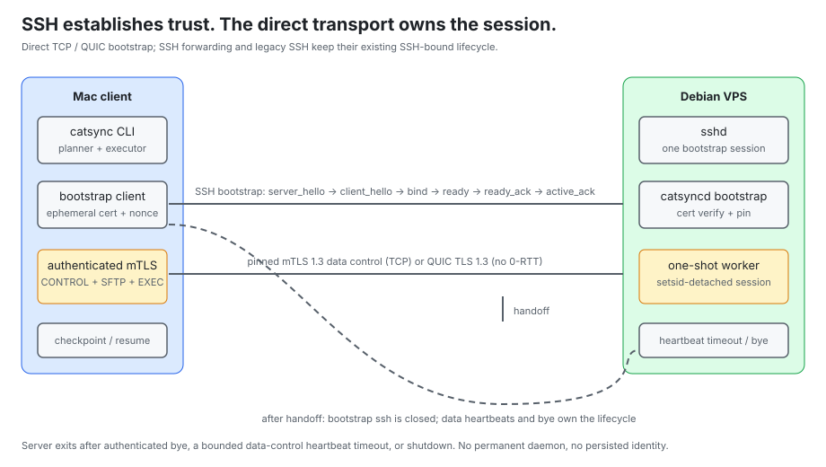

<div align="center">

# CatSync

**Parallel, resumable file-tree transfers over SSH.**

A single Go binary. No remote daemon required. Conservative by default.

[](https://github.com/dotfrankruan/CatSync/actions/workflows/ci.yml)
[](https://github.com/dotfrankruan/CatSync/releases)
[](go.mod)
[](LICENSE)

[Quick start](#-quick-start) · [Install](#-install) · [How it works](#-how-it-works) · [Docs](#-documentation) · [Benchmarks](docs/benchmark.md)

</div>

---

## ✨ Why CatSync?

CatSync is built for the annoying transfer that a single `scp` or `rsync`
invocation does not handle well: a large tree, a flaky link, and no desire to
start over from byte zero.

- 🚀 **Parallel by design** — small files move in batched `rsync` jobs; large files use multiple native SFTP streams.
- 🧭 **Plan first** — every path gets one owner before anything is written. You can inspect the plan before touching the destination.
- 🛡️ **No clobber** — existing destination files are never overwritten by `copy`; `sync` is the only mode allowed to delete extras.
- ⏯️ **Resume anything** — chunk checkpoints and atomic state make an interrupted transfer resumable with the same command.
- 🔐 **Ephemeral identities** — the optional daemon transport uses fresh P-256 certificates, pinned mutual TLS 1.3, and never stores private keys.
- 🩺 **Verified completion** — size and SHA-256 checks are separate from the transfer itself.
- 🌐 **Works in both directions** — upload, download, single file, directory tree, copy, or exact mirror.

> Design rule: **SSH establishes trust. The direct transport owns the session. No permanent daemon. No silent fallback.**

## 🚀 Quick start

```bash
# 1. Check that ssh/rsync are available
catsync doctor

# 2. See what would happen
catsync plan ./data user@host:/srv/data

# 3. Add new/changed files — never deletes destination data
catsync copy ./data user@host:/srv/data

# 4. Exact mirror — the only mode that removes destination-only entries
catsync sync ./data user@host:/srv/data

# 5. Single file, remote to local
catsync copy user@host:/srv/archive.tar ./downloads
```

Interrupted? Run the same command again. CatSync resumes the matching run
automatically; `catsync resume <RUN_ID>` does the same explicitly and
`--fresh` starts over.

## 📦 Install

### Homebrew (macOS/Linux)

```bash
brew install dotfrankruan/catsync/catsync
```

The fully-qualified name auto-taps the repository and needs no extra trust
step. To install by short name after tapping explicitly:

```bash
brew tap dotfrankruan/catsync
brew trust dotfrankruan/catsync
brew install catsync
```

<details>
<summary><strong>Prefer a release archive or building from source?</strong></summary>

<br>

```bash
# macOS Apple silicon; replace the platform suffix as needed
curl -LO https://github.com/dotfrankruan/CatSync/releases/download/v0.2.0/catsync_v0.2.0_darwin_arm64.tar.gz
tar -xzf catsync_v0.2.0_darwin_arm64.tar.gz
install -m 0755 catsync_v0.2.0_darwin_arm64/catsync ~/.local/bin/catsync
```

From source:

```bash
make install   # installs catsync and catsyncd to ~/.local/bin
```

Or with Go directly:

```bash
go install github.com/dotfrankruan/CatSync/cmd/catsync@latest
go install github.com/dotfrankruan/CatSync/cmd/catsyncd@latest   # optional daemon agent
```

</details>

**Requirements:** Go 1.26+ to build. At runtime CatSync uses the system
`ssh`; `rsync` is needed for updated files and mirror sync. On the remote side:
`sshd` with `sftp-server`, `rsync`, and GNU findutils. No remote daemon is
required for the default transport.

## 🧭 Transport modes

| Mode | Flag | Data path | Notes |
| --- | --- | --- | --- |
| **SSH** (default) | — | system `ssh` / SFTP | Works with any SSH setup; one connection per data stream. |
| **Daemon TCP** | `--transport daemon` | pinned mTLS over TCP | One SSH bootstrap; the authenticated data channel can outlive it. |
| **Daemon QUIC** | `--transport daemon --daemon-transport quic` | pinned QUIC TLS 1.3 | Experimental; one UDP connection, multiplexed streams, no 0-RTT. |
| **Daemon SSH-forward** | `--transport daemon --daemon-bootstrap ssh-forward` | mTLS inside an SSH tunnel | The tunnel is required for the whole transfer. |

### ⚡ Optional daemon transport

Direct TCP and direct QUIC start with a single SSH bootstrap, exchange fresh
in-memory certificates, then hand the session to the authenticated data
control channel. The bootstrap SSH process can exit; data heartbeats and the
final authenticated `bye` own the rest of the run. The remote `catsyncd` is a
one-shot worker and exits when the transfer ends or when the client disappears.

```bash
catsync copy --transport daemon ~/src user@host:/data
```

`catsyncd` must already be installed on the remote host — CatSync never
downloads, copies, or installs it. See
[docs/usage.md](docs/usage.md#daemon-transport-one-shot-catsyncd) for the
security model, SSH-forward behavior, QUIC diagnostics, and resume semantics.

<details>
<summary><strong>Daemon lifecycle at a glance</strong></summary>

<br>

```text
SSH bootstrap
  → ephemeral identities + exact pinning
  → pinned mTLS TCP / QUIC data control
  → authenticated handoff
  → SSH bootstrap exits
  → data + heartbeats continue
  → authenticated bye
  → one-shot worker exits
```



</details>

## 🛡️ Built for safe transfers

- **One owner per path.** Planning assigns every relative path to exactly one backend; stages never race for the same destination file.
- **Conservative by default.** `copy` never deletes destination entries. `sync` is explicit and performs deletion only in its final mirror pass.
- **Crash-aware state.** Run state is written atomically; checkpoints are validated before resume; advisory destination locks are released by the kernel after a crash.
- **Verification is a gate.** The default `auto` policy checks size first, then SHA-256 when the remote side has a hashing tool. Strict `--verify sha256` fails instead of falling back.
- **No long-lived secrets.** Daemon identities exist only in memory for one run. There is no persistent certificate, token, or session key.

## 🔄 Resume an interrupted transfer

Run the same `copy`, `sync`, or `download` command again. CatSync finds the
matching run, revalidates the source, and resumes pending work; in-flight state
is recovered automatically. List recorded runs with `catsync status`, or resume
one explicitly with `catsync resume <RUN_ID>`.

## 🧱 How it works

1. 🔍 **Discover** the source tree and collect destination metadata.
2. 🗺️ **Plan** one backend per path and make the plan immutable for the run.
3. ⚡ **Transfer** small files in parallel batches and large files with native
   multistream SFTP.
4. ✅ **Verify** size and SHA-256 as requested, then publish safely.
5. 🪞 **Mirror** only for `sync`, after all optimized stages succeed.

The daemon transport swaps the remote transport implementation — not the
planner, checkpoint format, publish rules, or verification logic.

## 📚 Documentation

Start at the [documentation index](docs/README.md), or jump straight in:

| | |
| --- | --- |
| 🧰 [Usage](docs/usage.md) | Commands, options, backend selection, authentication, troubleshooting. |
| 🏗️ [Architecture](docs/architecture.md) | Transfer stages, checkpoints, state model, and SSH lifecycle handoff. |
| 📊 [Benchmarks](docs/benchmark.md) | Measured transport performance, real SSH handoff tests, and limitations. |
| 🚀 [Releasing](docs/releasing.md) | Tagging, release archives, and Homebrew. |
| 📄 [Third-party notices](third_party/) | Licenses of linked Go modules. |

## ⚠️ Current limitations

- **QUIC is experimental.** The direct QUIC lifecycle works, but the known
  quic-go public-network `decryption_failure` / idle-timeout issue is still
  possible on some paths. CatSync never silently downgrades transports.
- **SSH-forward is intentionally SSH-bound.** Its data path lives inside the
  SSH tunnel, so losing SSH terminates that transfer.
- **A lost direct data connection is resumable, but not recoverable without
  SSH.** This release decouples an active direct session from its bootstrap;
  it does not add passwordless re-authentication of a new session.
- **The remote `catsyncd` must be installed by you.** CatSync does not install
  or copy it.

## 🛠️ Development

```bash
make test     # go test ./...
make check    # gofmt, go vet, go test -race
make cross    # dist/ binaries: linux/amd64, linux/arm64, darwin/amd64, darwin/arm64
make release  # versioned archives + SHA256SUMS, as published on a tag
```

CI runs the same checks on Linux and macOS for every push and pull request —
see [`.github/workflows/ci.yml`](.github/workflows/ci.yml).

## 🙏 Acknowledgements

Early CatSync releases orchestrated the external `fpsync`, `fpart`, and `mscp`
tools. Those integrations have been replaced by native implementations; no
code from those projects is part of CatSync.

## 📄 License

[AGPL-3.0-only](LICENSE) — your data belongs to you, not us.
