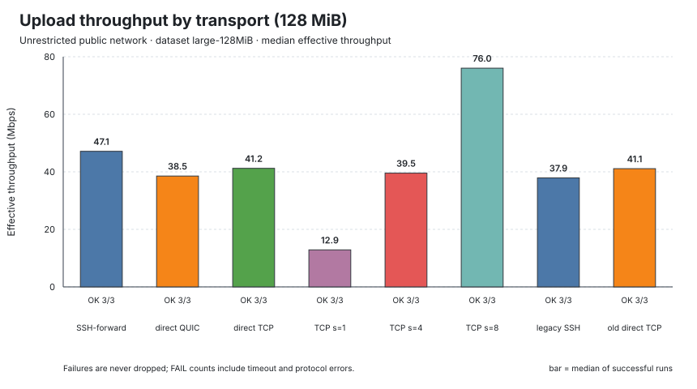
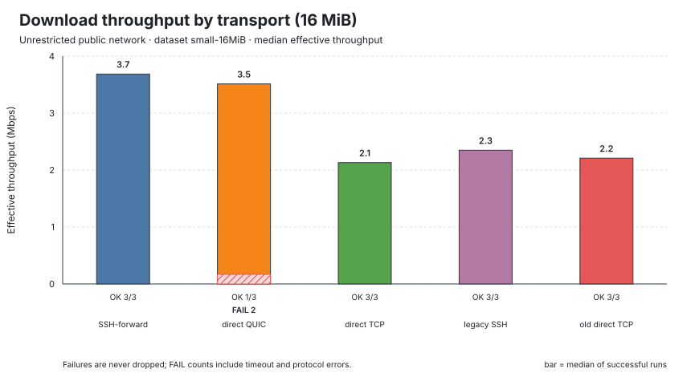

# CatSync detached SSH lifecycle benchmark

This document reports the measured results for the SSH bootstrap lifecycle
handoff. It separates unrestricted public-network measurements from the
controlled-bandwidth work, which is marked **SKIP** because the required
network privileges were not available. Every number comes from this round's
machine-readable raw data; failed runs are kept in the tables and are not
silently removed.

Implementation under test: the local workspace on top of commit `998c169`
(the pre-detach comparison is the published v0.2.0 binaries). Test date:
2026-11-22.

## 1. Executive Summary

The lifecycle goal was achieved on a real OpenSSH path:

- Direct TCP and direct QUIC complete a one-time SSH bootstrap, establish
  pinned mTLS/QUIC, hand ownership to the authenticated data control channel,
  and continue after the bootstrap SSH exits.
- In the normal TCP acceptance case the SSH process closed at **1.50 s**
  while the direct data session continued until **25.85 s**, with a matching
  SHA-256.
- In the deliberate `SIGKILL` case, only the client-side bootstrap SSH was
  killed at **1.95 s**; the authenticated direct transfer continued until
  **33.41 s** and the SHA-256 matched. No second bootstrap SSH was observed.
- The same normal and SIGKILL cases succeeded for direct QUIC with a 1 MiB
  data set. QUIC's separate low-bandwidth failure is discussed in
  [Limitations](#13-limitations-and-known-issues).
- Every tested worker disappeared after the final authenticated bye. After a
  client `SIGKILL`, the worker disappeared in **38.68 s**, inside the bounded
  data-control heartbeat timeout.

Throughput summary (unrestricted public network; median of successful runs):

- 128 MiB upload: legacy SSH **37.9 Mbps**, SSH-forward **47.1 Mbps**,
  direct TCP **41.2 Mbps**, direct QUIC **38.6 Mbps**, pre-detach direct TCP
  **41.1 Mbps**.
- 16 MiB download: SSH-forward **3.7 Mbps**, direct TCP **2.1 Mbps**,
  legacy SSH **2.4 Mbps**, pre-detach direct TCP **2.2 Mbps**. Direct QUIC had
  **1 success and 2 failures**; its one successful run reached 3.5 Mbps.
- Direct TCP stream scaling for the 128 MiB upload: **12.9 Mbps** at one
  stream, **39.6 Mbps** at four streams, **76.0 Mbps** at eight streams.
- Handoff itself is small relative to the transfer: median direct-TCP
  handoff **64 ms**, direct-QUIC handoff **31 ms**; bootstrap plus
  authenticated control was **369-419 ms**.
- The pre-detach TCP baseline and the detached TCP build are statistically
  indistinguishable for upload; no throughput regression is visible in this
  environment. Download numbers vary with the public path and are not
  evidence of an implementation speedup.

Controlled bandwidth, high-RTT, loss, and isolated-LAN tests: **SKIP** (no
sudo/qdisc/firewall access; shaping only one port would be unfair). The
public-network baseline is the primary result, and no controlled numbers are
invented.

## 2. Architecture Under Test

```text
SSH bootstrap (one session)
  -> ephemeral P-256 identities + exact leaf pinning
  -> pinned mTLS 1.3 data control / QUIC TLS 1.3 (no 0-RTT)
  -> authenticated handoff request bound to the bootstrap session id
  -> server confirms detached and closes SSH stdio
  -> client kills only its local bootstrap ssh
  -> authenticated data heartbeats + bye own the session
  -> one-shot worker exits
```

See [assets/ssh-handoff.svg](assets/ssh-handoff.svg).

| Mode | Bootstrap | Data path | SSH dependence after handoff |
| --- | --- | --- | --- |
| Legacy SSH | none | SFTP/rsync over SSH | Not applicable; unchanged |
| daemon SSH-forward | one SSH | mTLS inside the SSH tunnel | SSH must stay alive |
| daemon direct TCP | one SSH | pinned mTLS TCP | None after handoff |
| daemon direct QUIC | one SSH | pinned QUIC TLS 1.3 | None after handoff |
| pre-detach direct TCP | one SSH | old v0.2.0 daemon lifecycle | Baseline: SSH-bound |

## 3. Test Environment

- Client: MacBook Pro, Apple M5, 16 GB RAM, macOS 27.2.1, Go 1.27.4
  (darwin/arm64).
- Server: Debian 13, Linux 6.12.95+deb13-amd64, 2 vCPU, 1973 MB RAM,
  x86_64, public IPv4 test VPS (host details sanitized).
- RTT: ICMP 5 probes, min/avg/max = **16.761 / 17.941 / 20.863 ms**,
  0% packet loss.
- VPS nominal bandwidth is 100 Mbps download / 4 Mbps upload. The provider
  does not guarantee a fixed rate; the observed rate varied between runs.
- Default `catsyncd` receive-buffer warning was present (`wanted 7168 KiB,
  got 416 KiB`); no sysctl or privileged tuning was performed.
- No sudo, root, qdisc, sysctl, firewall, cloud-security-group, or service
  changes were made on the VPS.

## 4. Hardware / OS / Software Versions

| Component | Version / detail |
| --- | --- |
| Client CPU | Apple M5 |
| Client OS | macOS 27.2.1 (build 26B131) |
| Go toolchain | go1.27.4 darwin/arm64 |
| Server OS | Debian 13, kernel 6.12.95+deb13-amd64 |
| Server CPU | 2 vCPU, x86_64 |
| Server RAM | 1973 MB total |
| SSH | system OpenSSH; real sshd on the test VPS |
| quic-go | v0.65.0 (repository dependency) |
| Catsync under test | workspace detached-lifecycle build |
| Pre-detach baseline | v0.2.0 (`catsync` + `catsyncd.pre-detach`) |

## 5. Dataset and Methodology

Datasets are generated deterministically with
`scripts/benchmarks/make_dataset.py`:

- **large-128MiB**: one 128 MiB random file (seed 20261122), enough to
  exercise the native multistream path.
- **small-16MiB**: one 16 MiB random file, used for downloads to respect the
  VPS 4 Mbps upload direction.
- **mixed-1001-files**: 1000 small files plus one 8 MiB file and one empty
  file, with Unicode, spaces, and hidden names; 1002 regular files total.

Every run used identical workloads:

```bash
catsync copy --transport <mode> --jobs 4 --streams 4 --large-threshold 1MiB \
  --progress never --verify sha256 <source> <destination>
```

Each condition was repeated **3 times**; the tables report the median of
successful runs, the min/max range, and the failure count. Failures are not
removed. A run was successful only if the client exited 0 and its
`--verify sha256` completion gate passed. Large uploads use four jobs and four
streams unless the stream-scan variant explicitly says otherwise. Download
runs use the same settings and the same 16 MiB source.

The benchmark runner records wall-clock phases from an opt-in
`CATSYNC_BENCH_TIMING` JSONL diagnostic (disabled by default): bootstrap
start, authenticated data-control readiness, handoff start/ack, SSH close,
and client close. Local child CPU is measured with `getrusage`; remote CPU
and RSS were not sampled to avoid adding observation load. The supplemental
NIC probe reads VPS interface counters before and after one 16 MiB transfer
per mode; those readings include the observation SSH connections.

## 6. Baseline Results

The pre-detach v0.2.0 lifecycle was measured with the published v0.2.0 client
and the saved pre-detach `catsyncd`, using the same dataset and flags. It
uses SSH for the entire run (no detached worker).

| Workload | Mode | n | OK | Fail | Median Mbps | Min/Max | Median elapsed |
| --- | --- | ---: | ---: | ---: | ---: | --- | ---: |
| 128 MiB upload | pre-detach direct TCP | 3 | 3 | 0 | 41.09 | 37.8/42.8 | 26.1 s |
| 16 MiB download | pre-detach direct TCP | 3 | 3 | 0 | 2.21 | 2.2/2.3 | 60.8 s |
| 1002-file upload | pre-detach direct TCP | 3 | 3 | 0 | 3.38 | 3.4/3.4 | 19.9 s |

The new direct-TCP upload median (41.20 Mbps) is effectively the same as the
old lifecycle (41.09 Mbps) in this noisy public network. The new direct TCP
download is not faster in these samples; the public path is the dominant
variable, and no speedup is claimed.

## 7. Detached SSH Lifecycle Results

### 7.1 Real OpenSSH normal and forced-kill cases

Raw data: `docs/assets/benchmarks/lifecycle.json`. Large TCP cases use the
128 MiB file; QUIC cases use a 1 MiB file because of the known public-path
QUIC problem described in Limitations.

| Case | Transport | SSH end | Data end | SHA-256 | Worker PID same after handoff | Second SSH | Worker exited |
| --- | --- | ---: | ---: | --- | --- | --- | --- |
| Normal handoff + natural close | direct TCP | 1.505 s | 25.85 s | match | yes | no | yes |
| Bootstrap SSH SIGKILL after handoff | direct TCP | 1.945 s (kill) | 33.41 s | match | yes | no | yes |
| Normal handoff + natural close | direct QUIC | 1.434 s | 2.73 s | match | yes | no | yes |
| Bootstrap SSH SIGKILL after handoff | direct QUIC | 1.953 s (kill) | 9.61 s | match | yes | no | yes |

The SSH process in the normal case was the client-side bootstrap `ssh`
child; it exited after handoff. The data end is the client's final close
after transfer plus verification. In the forced-kill cases a separate
`kill -9` targeted only that client-side SSH PID. The transfer continued,
the remote worker PID remained the same, and the final remote SHA-256 matched
the local source.

No second bootstrap SSH was observed in the client process tree after the
handoff/kill. The observation `pgrep`/hash commands are separate short SSH
sessions and are not part of the transfer.

### 7.2 Client death cleanup

`docs/assets/benchmarks/cleanup.json` records a separate run where the
client was killed with `SIGKILL` after the worker was established:

- client killed at 2.42 s;
- remote one-shot worker exited **38.68 s after the client kill**;
- no worker remained afterwards.

The exit is bounded by the data-control heartbeat timeout (30 s default) plus
drain handling; this is intentional, not a permanent daemon.

## 8. Upload Benchmarks

Unrestricted public network, 128 MiB upload, 3 repeats per condition.



| Mode | n | OK | Fail | Median Mbps | Min/Max | Median elapsed | Median CPU user+sys |
| --- | ---: | ---: | ---: | ---: | --- | ---: | ---: |
| daemon SSH-forward | 3 | 3 | 0 | 47.12 | 42.3/48.2 | 22.8 s | 2.48 s |
| daemon direct QUIC | 3 | 3 | 0 | 38.55 | 32.9/45.9 | 27.9 s | 10.10 s |
| daemon direct TCP | 3 | 3 | 0 | 41.20 | 39.4/41.9 | 26.1 s | 1.30 s |
| legacy SSH | 3 | 3 | 0 | 37.89 | 35.8/40.9 | 28.3 s | 2.25 s |
| pre-detach direct TCP | 3 | 3 | 0 | 41.09 | 37.8/42.8 | 26.1 s | 1.37 s |

Direct QUIC used substantially more client CPU than TCP for this workload
(10.1 s user+sys vs 1.3 s), which is visible in the resource table but is not
a reason to call one transport universally better.

The mixed 1002-file upload had **no failures** in 3 runs:

| Mode | n | OK | Fail | Median Mbps | Median elapsed |
| --- | ---: | ---: | ---: | ---: | ---: |
| daemon direct TCP | 3 | 3 | 0 | 3.55 | 18.9 s |
| daemon direct QUIC | 3 | 3 | 0 | 3.69 | 18.2 s |
| pre-detach direct TCP | 3 | 3 | 0 | 3.38 | 19.9 s |

## 9. Download Benchmarks

Unrestricted public network, 16 MiB download. Direct QUIC had repeated
failures on this path; they are retained in the chart and table.



| Mode | n | OK | Fail | Median Mbps (successes) | Min/Max | Median elapsed |
| --- | ---: | ---: | ---: | ---: | --- | ---: |
| daemon SSH-forward | 3 | 3 | 0 | 3.69 | 3.7/3.7 | 36.4 s |
| daemon direct QUIC | 3 | 1 | **2** | 3.51 | 3.5/3.5 | 38.2 s (success) |
| daemon direct TCP | 3 | 3 | 0 | 2.13 | 2.1/2.2 | 63.0 s |
| legacy SSH | 3 | 3 | 0 | 2.35 | 2.3/2.4 | 57.2 s |
| pre-detach direct TCP | 3 | 3 | 0 | 2.21 | 2.2/2.3 | 60.8 s |

The direct-TCP download rate is not presented as an improvement; it is
within public-network variation and is actually below SSH-forward in this
sample. The direct-QUIC failures are the known quic-go path issue, not a
handoff failure: the 1 MiB lifecycle test above completed normally, while
the 16 MiB download failed after partial progress with the existing
`decryption_failure`/idle-timeout signature.

## 10. Stream Concurrency

128 MiB direct-TCP upload, same client/server and dataset:

| Streams | n | OK | Fail | Median Mbps | Min/Max | Median elapsed |
| ---: | ---: | ---: | ---: | ---: | --- | ---: |
| 1 | 3 | 3 | 0 | 12.87 | 10.4/12.9 | 83.4 s |
| 4 | 3 | 3 | 0 | 39.55 | 39.3/43.2 | 27.1 s |
| 8 | 3 | 3 | 0 | 76.03 | 75.3/76.4 | 14.1 s |

Eight streams used the VPS download capacity better on this run; the result
is workload- and path-dependent, not a promise that more streams is always
faster. No stream count was silently reduced.

## 11. Failure Injection and Recovery

- **SSH kill after handoff, TCP**: transfer completed, SHA-256 matched,
  worker exited, no second SSH.
- **SSH kill after handoff, QUIC (1 MiB)**: transfer completed, SHA-256
  matched, worker exited, no second SSH.
- **SSH kill during SSH-forward data transfer**: the client exited non-zero
  with a failed task; the one-shot worker was gone. SSH-forward did not
  pretend to be detachable, which is the intended negative behavior.
- **Client SIGKILL after handoff**: worker exited in 38.68 s and no worker
  remained; see `cleanup.json`.
- **Handoff security tests**: wrong bootstrap session id is rejected without
  closing the SSH bootstrap or detaching; duplicate handoff returns
  `detached` without starting a second worker; heartbeat/bye are rejected
  before handoff; HTTP 404/unknown-path and `FEATURE_UNAVAILABLE` are treated
  as explicit "unsupported handoff" and the client keeps the SSH-bound
  lifecycle with a warning.
- **Compatibility checks**: new client ↔ old v0.2.0 server completed with a
  warning and old SSH-bound lifecycle; old v0.2.0 client ↔ new server
  completed; the new state documents remain readable by the new binary. See
  Limitations for state-format one-way compatibility.

Data-connection failure itself is safe-fail + checkpoint/resume; this round
does not implement a no-SSH re-authentication of a *new* direct session.

## 12. Resource Usage

Per-run local child CPU medians (user+sys) are in the upload table. A few
representative values:

| Workload | Mode | Median CPU user+sys | Note |
| --- | --- | ---: | --- |
| 128 MiB upload | direct TCP | 1.30 s | lowest measured among large-upload modes |
| 128 MiB upload | direct QUIC | 10.10 s | quic-go cryptography/stream overhead |
| 128 MiB upload | SSH-forward | 2.48 s | includes SSH encryption/tunnel |
| 128 MiB upload | legacy SSH | 2.25 s | includes SSH/SFTP and rsync processes |
| 1002-file upload | direct TCP | 4.38 s | small-file metadata/rsync dominates |
| 1002-file upload | direct QUIC | 5.11 s | includes QUIC control/stream overhead |

`maxrss_kb` in `results.json` is the maximum child RSS seen by the benchmark
process (macOS reported bytes converted to KiB); it is cumulative and is not
a per-run peak, so it is not used to rank modes.

Supplemental VPS NIC probe for a 16 MiB upload (`network.json`; includes the
observation SSH connections):

| Mode | Remote `eth0` RX | Payload | RX/payload | Remote `eth0` TX |
| --- | ---: | ---: | ---: | ---: |
| legacy SSH | 17,702,775 B | 16,777,216 B | 1.055 | 127,489 B |
| daemon SSH-forward | 17,866,706 B | 16,777,216 B | 1.065 | 106,170 B |
| daemon direct TCP | 17,843,698 B | 16,777,216 B | 1.064 | 121,142 B |
| daemon direct QUIC | 17,837,274 B | 16,777,216 B | 1.063 | 148,561 B |

The NIC deltas include bootstrap, observation SSH, framing, and control
traffic, so they are an end-to-end overhead indicator rather than pure data
encapsulation accounting.

## 13. Limitations and Known Issues

### Controlled bandwidth: SKIP

The VPS was accessed only as the unprivileged `catsync-test` account. There
was no permission to change the VPS qdisc, sysctl, firewall, cloud security
group, or to install a traffic-control service. Shaping only the daemon port
43411 UDP/TCP while leaving SSH port 22 unshaped would compare unequal
networks; inserting a user-space proxy only into the daemon path would be
equally unfair. Controlled-bandwidth, high-RTT, loss, and isolated-LAN
results are therefore **SKIP**, not failed measurements and not omitted
successes. No controlled figures are included.

### QUIC

Direct QUIC uploads at 128 MiB completed in all 3 runs, and the 1 MiB handoff
and SSH-kill cases completed. However, 2 of 3 16 MiB downloads failed on the
unrestricted public path. These are the previously investigated quic-go
`decryption_failure`/idle-timeout symptoms on this network path, not a
handoff-state failure: the handshake and authenticated handoff were already
complete, and the failure occurred later on the data path. The direct-QUIC
lifecycle support is implemented and verified, but QUIC remains
**experimental**; CatSync does not silently downgrade to TCP.

### Public-network variability

The VPS provider does not guarantee a constant 100/4 Mbps rate. Upload and
download medians and the apparent ordering of legacy SSH, SSH-forward, and
direct TCP varied between runs. Direct-TCP download was slower than
SSH-forward in this sample even though direct-TCP upload matched the
pre-detach baseline; this is reported without claiming an implementation
regression or improvement.

### Other

- Remote CPU/RSS were not sampled to avoid observation load; only local child
  CPU is reported.
- NIC counters were collected per run only in the supplemental 16 MiB probe,
  not per benchmark row.
- The benchmark does not test FIDO2/security-key re-authentication; the
  acceptance held an already authenticated SSH session, as intended. No
  attempt was made to bypass authentication.
- Run-state compatibility is one-way: new binaries read older additive state,
  but old binaries may reject fields written by newer releases. Upgrade all
  clients sharing a state directory. A shadowed old `catsync` in `PATH` can
  produce `unknown field "transport"`; see docs/usage.md Troubleshooting.
- SSH-forward intentionally remains SSH-dependent; it is not advertised as
  detached.
- A direct data connection that dies cannot be resumed without a new trusted
  SSH bootstrap; only the active run's already-established direct session is
  decoupled from SSH.

## 14. Reproduction Instructions

Generate the deterministic datasets:

```bash
python3 scripts/benchmarks/make_dataset.py --root /tmp/catsync-bench-data
```

Run the public-network matrix (3 repeats; host environment variables select
the authorized test VPS):

```bash
CATSYNC_BENCH_HOST=catsync-test@example.invalid \
python3 scripts/benchmarks/run.py \
  --binary ./bin/catsync \
  --old-binary /path/to/v0.2.0/catsync \
  --remote-catsyncd /home/catsync-test/.local/bin/catsyncd \
  --old-remote-catsyncd /home/catsync-test/.local/bin/catsyncd.pre-detach \
  --data /tmp/catsync-bench-data \
  --out docs/assets/benchmarks/results.json --reps 3
python3 scripts/benchmarks/render.py
python3 scripts/benchmarks/summarize.py
```

Real OpenSSH lifecycle acceptance and fault injection:

```bash
CATSYNC_E2E_HOST=catsync-test@example.invalid \
python3 scripts/tests/real-ssh-handoff.py \
  --binary ./bin/catsync \
  --remote-catsyncd /home/catsync-test/.local/bin/catsyncd \
  --source /tmp/catsync-bench-data/large/large.bin \
  --data-transport tcp \
  --out docs/assets/benchmarks/lifecycle.json

CATSYNC_E2E_HOST=catsync-test@example.invalid \
python3 scripts/tests/worker-timeout.py \
  --binary ./bin/catsync \
  --remote-catsyncd /home/catsync-test/.local/bin/catsyncd \
  --out docs/assets/benchmarks/cleanup.json
```

Supplemental NIC probe:

```bash
CATSYNC_BENCH_HOST=catsync-test@example.invalid \
python3 scripts/benchmarks/network_probe.py \
  --binary ./bin/catsync \
  --remote-catsyncd /home/catsync-test/.local/bin/catsyncd \
  --out docs/assets/benchmarks/network.json
```

The runner and acceptance scripts remove only their dedicated remote test
directories and processes; they do not install a service or change system
configuration. The QUIC lifecycle cases use a 1 MiB source to avoid mixing the
known QUIC data-path failure with handoff verification; the benchmark's
16 MiB downloads retain the failure counts.

## 15. Raw Data References

Machine-readable data:

- [`results.json`](assets/benchmarks/results.json) - 48 benchmark runs with
  success/failure, elapsed, CPU, timing phases, and sanitized environment.
- [`lifecycle.json`](assets/benchmarks/lifecycle.json) - four real OpenSSH
  normal/SIGKILL cases (TCP and QUIC).
- [`cleanup.json`](assets/benchmarks/cleanup.json) - client SIGKILL worker
  timeout.
- [`network.json`](assets/benchmarks/network.json) - supplemental VPS NIC
  counters.

Generated charts:

- [Upload throughput](assets/benchmarks/upload-throughput.svg)
- [Download throughput](assets/benchmarks/download-throughput.svg)
- [Handoff latency](assets/benchmarks/handoff-latency.svg)
- [SSH lifecycle](assets/benchmarks/ssh-lifecycle.svg)

Generators and harnesses:

- `scripts/benchmarks/make_dataset.py`
- `scripts/benchmarks/run.py`
- `scripts/benchmarks/render.py`
- `scripts/benchmarks/summarize.py`
- `scripts/benchmarks/network_probe.py`
- `scripts/tests/real-ssh-handoff.py`
- `scripts/tests/worker-timeout.py`

## 16. Conclusion

The central acceptance facts are demonstrated on a real Debian VPS with real
OpenSSH:

1. After the SSH bootstrap, direct TCP and direct QUIC continue working
   without SSH; the normal acceptance case closed SSH at 1.50 s and completed
   the transfer at 25.85 s with a matching SHA-256.
2. A deliberate SIGKILL of the bootstrap SSH at 1.95 s did not stop the
   already handed-off direct transfer; it completed at 33.41 s with a matching
   SHA-256 and no second SSH.
3. The one-shot remote worker exits after normal completion and after client
   death (38.68 s after SIGKILL), leaving no permanent daemon.

The detached TCP lifecycle adds no measurable upload-throughput regression
against the v0.2.0 SSH-bound baseline in this environment. The absolute
throughput differences among modes are dominated by public-network
variability and workload shape. QUIC lifecycle handoff works, but QUIC's
known public-path data failure remains, so QUIC stays experimental. The
controlled-bandwidth portion is explicitly SKIP because the required network
privileges were not available.
